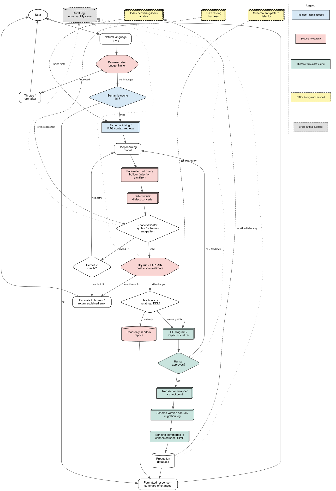
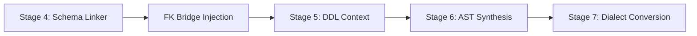
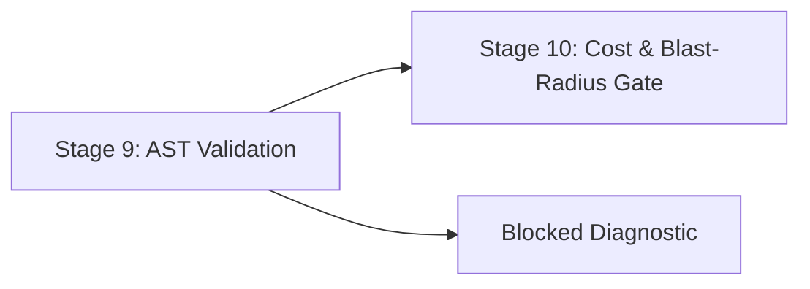
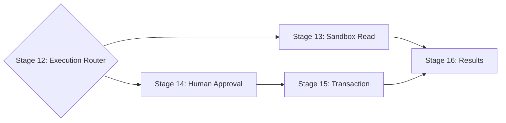

<div align="center">

# NL2SQL - natural language to universal DBMS query converter

[](https://github.com/VanshikaKritiSingh/NL2SQL)
[](https://github.com/VanshikaKritiSingh/NL2SQL)
[](https://github.com/tobymao/sqlglot)
[](LICENSE)


<br />

**Overview:** [Summary](#executive-summary) &bull; [Design Intuition](#design-intuition) &bull; [Architecture](#system-architecture)

**Assets:** [Blueprints](#interactive-specifications--visual-architecture-assets) &bull; [Transpilation](#universal-ast-transpilation-engine) &bull; [Docs Hub](#subsystem-documentation-hub)

**Get Started:** [Quick Start](#quick-start) &bull; [Checklist](#developer-action-plan) &bull; [Team](#engineering-team)

</div>

<br />

---

## Executive Summary

The **NL2SQL Production Pipeline** is an enterprise-grade compilation framework that transforms natural language requests into deterministic, semantically validated, and cost-controlled queries across **6 database paradigms** and **20+ relational dialects**.

### Core Architecture Guarantees
1. **Zero Unsupervised Production Writes:** Mutating queries (`INSERT`, `UPDATE`, `DELETE`) and schema migrations (`ALTER`, `DROP`, `CREATE`) are intercepted by a mandatory **Dual-Path Execution Router** and escalated to a visual human review gate.
2. **Deterministic Universal Transpilation:** Canonical ANSI/PostgreSQL AST is transpiled in `< 5ms` without runtime LLM token consumption into 20+ SQL dialects (PostgreSQL, MySQL, SQLite, DuckDB, Snowflake, BigQuery, ClickHouse, etc.) via `sqlglot`.
3. **Speculative Intent Routing (DSpark Principles):** Fast CLEF-style discourse classifier (< 2ms) routes queries with speculative confidence scheduling and auto-mode divergence guardrails.
4. **Hybrid Schema Grounding:** Combines snake_case-aware BM25 and character N-gram fuzzy salience merged via **Reciprocal Rank Fusion (RRF)**, backed by Steiner Minimal Tree foreign-key bridge join injection and sub-millisecond cell grounding.
5. **Consumer Hardware Feasibility:** 4-bit NF4 QLoRA fine-tuning fits consumer GPUs (< 7.5GB VRAM on RTX 4060 8GB / RTX 3060 12GB), quantizing to `Q4_K_M` GGUF for CPU inference (~4.3GB RAM).

---

## Design Intuition

The architecture of this pipeline is governed by five core engineering principles developed in response to production failure modes observed in raw LLM-to-database applications:

```
                  ┌─────────────────────────────────────────────────────────┐
                  │                 Natural Language Input                  │
                  └────────────────────────────┬────────────────────────────┘
                                               │
                                               ▼
                         [Principle 1: Schema Grounding & Steiner Tree]
                         Retrieve ONLY relevant tables & auto-inject FK bridges
                                               │
                                               ▼
                         [Principle 2: Deterministic Compilation]
                         Generate ONE Canonical AST ──► Transpile to 20+ dialects
                                               │
                                               ▼
                         [Principle 3: 6-Layer Static AST Gate]
                         Verify Parse, Policy, Schema & Semantics in memory
                                               │
                                               ▼
                         [Principle 4: Dual-Path Blast-Radius Gate]
                           /                                   \
                 Read-Only SELECT                     Mutating Write / High Blast
                        │                                       │
                        ▼                                       ▼
                 Sandbox Replica                      Human Visual Diff Gate
                                                      (Monaco SQL + React Flow ER)
                                                                │
                                                                ▼
                         [Principle 5: Native Database Isolation]
                         Execute inside real DB transaction with SAVEPOINT rollback
```

### 1. NL2SQL Is a Compiler Problem
Raw LLM output cannot be trusted to execute directly on production databases. LLMs hallucinate column names, fabricate joins, invent non-existent functions, and miss edge cases in dialect syntax. Treating NL2SQL as a **multi-stage compiler**—where the LLM is merely the parser from natural language to an intermediate abstract syntax tree (AST)—allows the downstream pipeline to verify, rewrite, and reject malformed queries with mathematical guarantees before execution.

### 2. Deterministic AST Transpilation Over Prompt Chaining
Attempting to prompt an LLM to generate 20+ different SQL dialects directly increases prompt size, multiplies token costs, and introduces subtle syntax errors across dialect versions. Instead, our design forces the model to emit a single **canonical ANSI/PostgreSQL AST**. A deterministic engine (`sqlglot`) then rewrites and transpiles that AST into target database dialects in `< 5ms` with zero runtime token spend and 100% syntactic determinism.

### 3. Unbroken Join Paths via Steiner Minimal Trees
Real enterprise schemas contain dozens or hundreds of tables. Injecting the entire catalog into an LLM prompt exhausts context limits and creates attention distraction. However, selecting only the tables mentioned in the user query often leaves tables disconnected. Our hybrid schema linker uses **Reciprocal Rank Fusion (BM25 + Fuzzy N-Gram)** to find seed tables, and then uses a **Steiner Minimal Tree** graph traversal across foreign-key relationships to automatically inject the intermediate "bridge tables" needed to connect them, preventing broken joins and Cartesian products.

### 4. Zero Unsupervised Production Mutations (Dual-Path Router)
A single hallucinated `DELETE` or unbounded `UPDATE` can cause catastrophic data loss. The pipeline enforces a hard architectural boundary:
- **Read Path:** Low-cost `SELECT` statements route automatically to read replicas or sandboxes.
- **Write / High-Risk Path:** Any mutating statement (`INSERT`, `UPDATE`, `DELETE`, `DROP`, `ALTER`) or any query exceeding cost/blast-radius thresholds is halted. It renders a side-by-side Monaco SQL diff and an interactive React Flow ER diagram showing affected downstream tables for explicit human review.

### 5. Native Database Isolation Over User-Space Simulation
Earlier iterations of the system attempted to build operating-system internals (WFQ schedulers, 2PL lock managers, Tarjan SCC deadlock detectors, virtual memory pagers) in Python user space. The **Ponytail Review** proved that simulating an OS in Python creates concurrency bottlenecks and lock leaks. Databases have spent 40 years perfecting ACID transactions, row-level locking, MVCC, and buffer pools. The true design intuition is to **delegate isolation to the database engine natively** via `BEGIN`, `COMMIT`, and `SAVEPOINT` transaction boundaries, dispatching queries concurrently via standard library `ThreadPoolExecutor`.

---

## Interactive Specifications & Visual Architecture Assets

The NL2SQL architecture is specified across interactive web specifications, vector SVG blueprints, and high-definition raster renders:

<div align="center">

<a href="docs/diagrams/SVG_DIAGRAM.svg"></a>

<p><em>Click the diagram above to inspect the full 1600x3560 vector SVG master blueprint (<a href="docs/diagrams/SVG_DIAGRAM.svg">docs/diagrams/SVG_DIAGRAM.svg</a>)</em></p>

</div>

### Visual & Interactive Specification Catalog

| Asset | Format | Location | Primary Purpose | How to View |
| :--- | :--- | :--- | :--- | :--- |
| **Interactive Architecture Spec** | Standalone HTML / SVG | [`docs/html/nl2sql.html`](docs/html/nl2sql.html) | Interactive 16-stage pipeline guide with inlined vector SVG, stage reference table, and academic citations | Open in browser (`open docs/html/nl2sql.html`) or serve via local HTTP server |
| **Master Architecture Blueprint** | Vector SVG (1600x3560) | [`docs/diagrams/SVG_DIAGRAM.svg`](docs/diagrams/SVG_DIAGRAM.svg) | High-precision vector architecture schematic with exact subsystem boundaries and stage markers | Open in browser, Figma, Miro, or Inkscape |
| **Pipeline High-Res Render** | 24-bit PNG | [`docs/diagrams/pipeline_v2_check.png`](docs/diagrams/pipeline_v2_check.png) | High-definition raster render for markdown renderers and presentation previews | Native image preview or GitHub file viewer |
| **Design Companion Template** | HTML / CSS | [`docs/html/template.html`](docs/html/template.html) | Design system typography, layout tokens, and interactive component prototypes | Open in browser (`open docs/html/template.html`) |
| **Architecture Reference Document** | Markdown | [`docs/NL2SQL-Pipeline-Architecture.md`](docs/NL2SQL-Pipeline-Architecture.md) | Stage-by-stage text specification and companion document to `docs/diagrams/SVG_DIAGRAM.svg` | Markdown viewer or GitHub |

#### Viewing the Interactive Web Specification Locally
```bash
# Option 1: Direct browser launch
# Linux
xdg-open docs/html/nl2sql.html
# macOS
open docs/html/nl2sql.html
# Windows
start docs\html\nl2sql.html

# Option 2: Local HTTP server
python -m http.server 8080 --directory docs/html/
# Then navigate to http://localhost:8080/nl2sql.html
```

---

## System Architecture

The pipeline executes through 16 human-supervised stages structured into four cohesive layers:








---

## Universal AST Transpilation Engine

A single canonical ANSI SQL AST is compiled deterministically into 20+ SQL targets in `< 5ms`:

```mermaid
flowchart LR
    classDef source fill:#0f172a,stroke:#38bdf8,stroke-width:2px,color:#f8fafc;
    classDef engine fill:#1e1b4b,stroke:#a855f7,stroke-width:2px,color:#f8fafc;
    classDef sql fill:#064e3b,stroke:#10b981,stroke-width:2px,color:#f8fafc;

    AST["Canonical ANSI/PostgreSQL AST<br/>(sqlglot Expression Tree)"]:::source --> ENGINE["Deterministic Dialect Transpiler<br/>(core/dialect_converter.py)"]:::engine

    ENGINE -->|"Native AST Re-writer"| SQL_GROUP["Relational & OLAP Engines"]:::sql
    subgraph SQL_GROUP ["20+ SQL & Cloud Data Warehouses"]
        SQL1["PostgreSQL & MySQL"]:::sql
        SQL2["SQLite & DuckDB"]:::sql
        SQL3["Snowflake & Google BigQuery"]:::sql
        SQL4["ClickHouse & StarRocks"]:::sql
        SQL5["Oracle & T-SQL / SQL Server"]:::sql
        SQL6["Trino, Presto & Apache Spark"]:::sql
    end
```



---

## Multi-Paradigm & Dialect Support

| Paradigm | Underlying Mechanism | Supported Dialects & Engines | Primary Workload Focus |
| :--- | :--- | :--- | :--- |
| **Relational (RDBMS)** | ANSI SQL & Relational Algebra | PostgreSQL, MySQL, SQLite, Oracle, T-SQL, MariaDB | Transactional consistency, normalized tables |
| **Column-Family / OLAP** | Vectorized Columnar Scanning | Snowflake, BigQuery, ClickHouse, DuckDB, Redshift, StarRocks, Trino, Spark SQL | Analytical aggregations, multi-billion row scans |
| **Embedded SQL** | Zero-Config Local In-Memory DB | SQLite, DuckDB | Development, testing, sandboxes |

---

## 6-Layer Static AST Validation Architecture

Every generated query undergoes a 6-layer verification pipeline before cost estimation or execution:

| Layer | Checks | Codes |
| :--- | :--- | :--- |
| 1. PARSE | Single statement, syntax and grammar | `PARSE_01/02` |
| 2. POLICY | Allowlist, dangerous DDL, no-WHERE guard | `POLICY_01–05` |
| 3. SCHEMA | Tables, columns, joins and aliases | `SCHEMA_01–04` |
| 4. SEMANTIC | GROUP BY, aggregate placement, INSERT parity | `SEM_01–03` |
| 5. QUERY ANTI-PATTERNS | Wildcards, Cartesian joins, unbounded ordering | `QUERY_AP_01/02/03/06` |
| 6. SCHEMA ANTI-PATTERNS | Missing primary keys, monetary FLOAT types | `SCHEMA_AP_01/06` |

---

## Offline Machine Learning & Fine-Tuning Suite

```mermaid
flowchart LR
    classDef stage fill:#1e1b4b,stroke:#818cf8,stroke-width:2px,color:#f8fafc;
    classDef artifact fill:#064e3b,stroke:#34d399,stroke-width:2px,color:#f8fafc;

    D_GEN["offline/datasets/prepare_dataset.py<br/>Multi-Schema Synthetic SFT Generator"]:::stage --> D_OUT["train.jsonl & eval.jsonl<br/>(ChatML Instruction Pairs)"]:::artifact
    
    D_OUT --> TRAIN["offline/training/train_qlora.py<br/>4-bit NF4 QLoRA SFT<br/>(Target All Linears, r=16, a=32)"]:::stage
    
    TRAIN --> ADAPTER["LoRA Checkpoints<br/>(< 7.5GB VRAM on RTX 4060)"]:::artifact
    
    ADAPTER --> EXPORT["offline/training/export_gguf.py<br/>16-bit Merge + GGUF Quantizer"]:::stage
    
    EXPORT --> GGUF["model-q4_k_m.gguf + Modelfile<br/>(~4.3GB RAM on CPU / Ollama)"]:::artifact
    
    GGUF --> EVAL["offline/training/evaluate.py<br/>AST Exact Match & SQLite EX Accuracy"]:::stage
```



---

<details>
<summary><strong>Repository structure</strong></summary>

```
NL2SQL/
|-- core/                            # Core Runtime Engine (AI/ML Backbone)
|   |-- paradigm_suggestor.py        # Intent drafter & dialect router
|   |-- schema_linker.py             # Hybrid BM25/Fuzzy RRF retrieval & Steiner join builder
|   |-- dialect_converter.py         # Deterministic AST transpiler (20+ SQL dialects)
|   |-- semantic_decomposer.py       # Intent classification & refusal tagging
|   |-- orchestrator.py              # Unified pipeline dispatcher & dual-path router
|   |-- validator/                   # 6-Layer Static AST Validator & Policy Guardrails
|   |   |-- contracts.py             # Immutable validation issue models & contracts
|   |   |-- engine.py                # 6-Layer static AST validation pipeline
|   |   |-- interfaces.py            # SchemaProvider & AuditLogger protocols
|   |   `-- rules/                   # Centralized RuleRegistry with dynamic toggles
|   |-- cost_estimator/              # Query Cost & Blast-Radius Estimator
|   |   |-- contracts.py             # Cost report structures & threshold definitions
|   |   |-- thresholds.py            # Configurable row scan and execution limits
|   |   `-- engine.py                # AST-driven heuristic cost & blast-radius engine
|   |-- connectors/                  # Production Relational Database Connectors
|   |   |-- base.py                  # Abstract database connector contract
|   |   |-- postgres.py              # PostgreSQL connector (psycopg2 / psycopg3)
|   |   |-- mysql.py                 # MySQL / MariaDB connector
|   |   |-- sqlite.py                # SQLite embedded connector
|   |   `-- duckdb_conn.py           # DuckDB columnar OLAP connector
|   `-- README.md                    # Dedicated AI/ML architectural handbook
|
|-- GUI/                             # Native Desktop & Web Interface Studio (Frontend & Systems)
|   |-- src/                         # React 18, TypeScript, Monaco Editor, React Flow ER Diagrams
|   |   |-- modules/
|   |   |   |-- query_intake/        # Query intake, Monaco editor, refusal cards, model selector
|   |   |   `-- approval_gate/       # React Flow ER graph, Monaco diffs, telemetry
|   |-- electron/                    # Electron container & native OS lifecycle bridge
|   |-- server/                      # FastAPI bridge server for pipeline integration
|   `-- README.md                    # Dedicated Desktop/Web Studio handbook
|
|-- docs/                            # Uniform Documentation Hub (Dated & Status-Tagged)
|   |-- README.md                    # Master Documentation Catalog & Status Index
|   |-- DEVELOPER_CHECKLIST.md       # Root symlink to active developer action plan
|   |-- checklists/                  # Active developer implementation checklists
|   |-- reviews/                     # Adversarial audits, ponytail bloat reviews, and design analyses
|   |-- plans/                       # Architectural decisions & implementation plans
|   |-- guides/                      # Integration guides, connector quickstarts & training runbooks
|   |-- reports/                     # Milestone evaluation reports & slide decks
|   |-- diagrams/                    # Vector SVG masters & PNG renders
|   `-- html/                        # Interactive web architecture specs
|
|-- offline/                         # AI/ML Offline Suite
|   |-- training/train_qlora.py      # 4-bit NF4 QLoRA fine-tuning script
|   |-- training/evaluate.py         # AST Exact Match & Execution Accuracy benchmark runner
|   |-- training/export_gguf.py      # LoRA merge & GGUF quantizer
|   `-- datasets/prepare_dataset.py  # Multi-schema synthetic dataset generator
|
|-- scripts/                         # Setup, Verification & Automation Scripts
|   |-- setup_linux.sh               # Automated environment bootstrap
|   |-- run_tests.sh                 # Verification test runner
|   `-- README.md                    # Setup automation documentation
|
`-- tests/                           # Comprehensive test suite (56/56 passing)
    |-- test_core_modules.py         # End-to-end multi-paradigm, refusal, and safety test suite
    |-- test_connectors.py           # Relational connector test suite
    |-- test_sanitizer_and_dialects.py # Transpilation & quote-aware sanitizer tests
    |-- test_er_schema.py            # ER schema metadata tests
    `-- test_centralized_core_architecture.py # Core architectural consistency tests
```

</details>

---

## Subsystem Documentation Hub

The NL2SQL repository follows a **Uniform, Dated, and Status-Tracked Documentation Architecture**. Every major design analysis, audit, implementation plan, and guide is tracked with its creation date and operational status (`[STATUS_ACTIVE]`, `[STATUS_OPEN]`, `[STATUS_IN_PROGRESS]`, `[STATUS_DONE]`, `[STATUS_SUPERSEDED]`).

For the complete catalog, see [`docs/README.md`](docs/README.md).

### Master Documentation Matrix

| Document | Category | Status | Purpose |
| :--- | :--- | :--- | :--- |
| **[Developer Action Plan](docs/DEVELOPER_CHECKLIST.md)** | Checklist | `[STATUS_ACTIVE]` | 41-task production hardening plan |
| **[Adversarial & Ponytail Audit](docs/reviews/audit.md)** | Review / Audit | `[STATUS_OPEN]` | Correctness flaws and over-engineering review |
| **[Decided Modules Plan](docs/DECIDED_MODULES.md)** | Plan | `[STATUS_PARTIAL]` | Stage allocations and module roles |
| **[GUI Integration Guide](docs/GUI_INTEGRATION_GUIDE.md)** | Guide | `[STATUS_DONE]` | FastAPI and frontend integration contracts |
| **[Connectors Quickstart](docs/CONNECTORS_QUICKSTART.md)** | Guide | `[STATUS_DONE]` | Connection strings and verification steps |
| **[Model Fine-Tuning Guide](docs/FINE_TUNE_GUIDE.md)** | Guide | `[STATUS_IN_PROGRESS]` | Consumer-GPU QLoRA training runbook |
| **[Pipeline Design Analysis](docs/DesignAnalysis.md)** | Review | `[STATUS_SUPERSEDED]` | Superseded architectural comparison |
| **[Phase-I Evaluation Report](docs/Phase-I_PBL_Evaluation.pptx.pdf)** | Report | `[STATUS_DONE]` | Milestone evaluation report |
| **[Architecture Reference Spec](docs/NL2SQL-Pipeline-Architecture.md)** | Specification | `[STATUS_BASELINE]` | 16-stage pipeline text specification |
| **[Interactive Web Spec](docs/html/nl2sql.html)** | Interactive | `[STATUS_BASELINE]` | Self-contained inline-SVG architecture guide |
| **[Master Vector Blueprint](docs/diagrams/SVG_DIAGRAM.svg)** | Diagram | `[STATUS_BASELINE]` | Full 1600x3560 architecture blueprint |

---

## Quick Start

### 1. Automated Environment Bootstrap

```bash
git clone https://github.com/VanshikaKritiSingh/NL2SQL.git
cd NL2SQL

chmod +x scripts/setup_linux.sh
./scripts/setup_linux.sh
```

---

### 2. Launch Full-Stack Pipeline (FastAPI Backend + Web Studio)

```bash
# Linux / macOS
./scripts/start_all.sh
```

> **Individual Services:**
> - Backend API Server: `./scripts/start_backend.sh`
> - Frontend Studio GUI: `./scripts/start_gui.sh`
> - Desktop Electron App: `./scripts/start_gui.sh --desktop`

---

### 3. Base Model Download & Offline Fine-Tuning

```bash
# Download foundation base model into offline/models/ (Presets: 0.5b, 1.5b, 7b, 7b-gguf)
./scripts/download_model.sh --preset 0.5b

# Start 4-bit NF4 QLoRA Fine-Tuning
./scripts/start_train.sh --epochs 3

# Run AST Exact Match & Execution Accuracy Evaluation
./scripts/start_eval.sh
```

---

### 4. Verification & Testing

```bash
# Run test suite across all subsystems (56 tests)
pytest -v
```

```
============================== 56 passed in 3.69s ==============================
- CLEF Drafter Intent Routing (Graph, Document, KV, OLAP): PASSED
- Paradigm Suggestor Auto Mode & Manual Guardrails: PASSED
- Dialect Transpilation (PostgreSQL, MySQL, SQLite, DuckDB): PASSED
- Categorical Value Trie Grounding: PASSED
- Steiner Tree FK Bridge Join Injection: PASSED
- 6-Layer Static AST Validator (Layers 1-6 & Anti-Patterns): PASSED
- Heuristic Cost & Execution Plan Estimator: PASSED
- End-to-End Orchestrator Dual-Path Routing: PASSED
- Quote-Aware Semicolon Script Splitter: PASSED
- Multi-Dialect Transpiler & DDL Generics: PASSED
- Centralized Core Architecture Imports: PASSED
- Relational Database Connector Invariants: PASSED
ALL 56 UNIT & INTEGRATION TESTS PASSED 100%!
```

---

## Developer Action Plan

> 41 actionable items across 4 phases. See the [full developer checklist](docs/checklists/2026-10-30_developer_todo_checklist_%5BSTATUS_ACTIVE%5D.md) for detailed rationale, locations, and fixes.

### Summary Scoreboard

| Category | Tasks | Focus Area | Target Impact |
|---|---|---|---|
| **1. Fix That** | 15 | Concurrency bugs, race conditions, inverted validation, false positives | Eliminates 29 critical/major production crash vectors |
| **2. There is No This** | 6 | De-illusions: fake Dolt CAS, single-thread WFQ, regex fallback | Replaces simulations with real DB savepoints & threadpools |
| **3. Implement This** | 5 | Missing security & reliability: parameterizer, rate limiter, cache | Full SQL injection safety & production resilience |
| **4. Delete / Strip This** | 15 | Bloat elimination: vendored trees, speculative connectors, shims | **-4,495 Python LOC**, **-52,604 vendored LOC (-211 MB)**, **-6 deps** |

---

<details>
<summary><strong>Detailed issue list</strong></summary>

### 1. "Fix That" (Critical Bugs & Broken Invariants)

- [ ] **FIX-01 (P0): Invert Validation Order — Transpile FIRST, Validate Target Dialect AST**
  - *Location:* `core/orchestrator.py:767-791`
  - *Problem:* Stage 7 transpiles; Stage 9 validates original PostgreSQL SQL. Target dialect queries run unvalidated, and transpilation errors forward raw PostgreSQL SQL to non-Postgres engines.
  - *Fix:* Move Stage 9 validation to run *after* dialect transpilation using the target dialect AST.
- [ ] **FIX-02 (P0): Defer Lock Release Until Approval — Stop Unlocked Production Execution**
  - *Location:* `core/orchestrator.py:573-585` & `GUI/server/routers/approval.py:44-86`
  - *Problem:* Locks are released in the `finally` block before human approval. Approved queries execute completely unlocked.
  - *Fix:* Hold execution intent in `PENDING_APPROVAL`; acquire transaction locks inside approval handler right before dispatch.
- [ ] **FIX-03 (P0): Eliminate Global Orchestrator Singleton — Prevent Cross-Tenant Schema Corruption**
  - *Location:* `GUI/server/routers/query.py:73, 185-209`
  - *Problem:* `orchestrator` is a global singleton; updating schema overwrites context for all concurrent users.
  - *Fix:* Scope orchestrator instances per user session or pass `SchemaMetadata` request-scoped.
- [ ] **FIX-04 (P0): Fix Lock Table Permanent Starvation upon Waiter Contention**
  - *Location:* `core/os_engine/lock_manager.py:73-115, 173-192`
  - *Problem:* `_grant_waiters()` fails to record granted resources in `_txn_locks`; `release_all()` pops an empty set, permanently leaking table locks.
  - *Fix:* Register granted resources into `_txn_locks`, or deprecate `core/os_engine/` in favor of native DB transactions.
- [ ] **FIX-05 (P0): Classify Lock Mode from Validated AST — Not Raw Substrings**
  - *Location:* `core/orchestrator.py:493-502`
  - *Problem:* Raw word scanning triggers exclusive write locks on queries like *"drop me an email with the salary report"*.
  - *Fix:* Determine lock mode strictly from validated AST statement type (`exp.Select` -> Read, `exp.Insert/Update/Delete` -> Write).
- [ ] **FIX-06 (P1): Fix Steiner Tree Bridge Table Slicing**
  - *Location:* `core/schema_linker.py:257-261`
  - *Problem:* Slicing `[:max_tables + 2]` drops bridge tables at the tail of FK paths, breaking joins and creating Cartesian products.
  - *Fix:* Prune non-bridge candidate tables before Steiner path discovery; preserve all bridge nodes.
- [ ] **FIX-07 (P1): Fix Layer 3 Validator False Positives on Aliased JOINs**
  - *Location:* `core/validator/engine.py:233-287`
  - *Problem:* Both alias and table name are entered into `all_known_cols`, causing unqualified columns to falsely trigger `SCHEMA_03: Ambiguous column`.
  - *Fix:* Deduplicate `all_known_cols` by physical table identity.
- [ ] **FIX-08 (P1): Use Quote-Aware Semicolon Splitting**
  - *Location:* `core/validator/engine.py:58-65` & `core/sanitizer.py:146`
  - *Problem:* Raw `split(";")` truncates queries containing semicolons inside string literals.
  - *Fix:* Use `split_sql_script()` from `core/sanitizer.py:32-137`.
- [ ] **FIX-09 (P1): Remove Silent Frontend Fallbacks Masking Server Crashes**
  - *Location:* `GUI/src/api/approvalApi.ts:12-14` & `GUI/src/api/queryApi.ts:16-33`
  - *Problem:* Frontend catches HTTP 500 errors and silently displays mock data.
  - *Fix:* Remove mock fallbacks in non-dev builds; surface real toast errors.
- [ ] **FIX-10 (P1): Fix Fine-Tuning Loss Masking & Chat Formatting**
  - *Location:* `offline/training/train_qlora.py:30-46, 132-140`
  - *Problem:* Prompt tokens are not masked (`labels = -100`) and `format_chat_prompt` is never mapped.
  - *Fix:* Map chat formatting and implement `DataCollatorForCompletionOnlyLM` to compute loss solely on SQL tokens.
- [ ] **FIX-11 (P1): Fix psycopg v3 Connection Manual Commit**
  - *Location:* `core/connectors/postgres.py:57-61`
  - *Problem:* psycopg v3 stays in manual commit mode without calling `commit()`; writes silently roll back on close.
  - *Fix:* Call `self._conn.commit()` after mutating query execution.
- [ ] **FIX-12 (P2): Fix MySQL Connector Mutating Shared Config In-Place**
  - *Location:* `core/connectors/mysql.py:249, 254`
  - *Problem:* Mutates `self.config.database` in-place on `USE` queries.
  - *Fix:* Store active database in ephemeral connection state.
- [ ] **FIX-13 (P2): Fix Schema Mismatch Guard Bypassing Unqualified Columns**
  - *Location:* `core/semantic_decomposer.py:309-316`
  - *Problem:* Skips check if `col.table` is None.
  - *Fix:* Resolve unqualified columns against all referenced tables.
- [ ] **FIX-14 (P2): Differentiate Refusal Comments from Executable READ Queries**
  - *Location:* `core/validator/engine.py:470-482`
  - *Problem:* Returns `StatementType.READ` for `-- REFUSAL:` comments.
  - *Fix:* Return dedicated `StatementType.REFUSAL`.
- [ ] **FIX-15 (P2): Fix Unbounded Response Cache Memory Leak**
  - *Location:* `GUI/server/routers/query.py:76-77`
  - *Problem:* `stored_responses` dict grows unbounded over server uptime.
  - *Fix:* Use `collections.OrderedDict` or `cachetools.LRUCache(maxsize=100)`.

---

### 2. "There is No This, Must Find an Alternative" (De-Illusions)

- [ ] **ALT-01: There is No Dolt CAS Checkpoint (Stage 15)**
  - *Reality:* Broadcasts hardcoded `"Dolt commit created: 9e4f2a"`. Zero Dolt client exists.
  - *Alternative:* Remove Dolt claims. Implement real database transaction savepoints (`SAVEPOINT sp_approval;` and `ROLLBACK TO SAVEPOINT;`).
- [ ] **ALT-02: There is No Concurrency in WFQScheduler (Stage 11)**
  - *Reality:* Single synchronous daemon thread; `max_inflight_reads=8` is impossible to reach.
  - *Alternative:* Delete `core/os_engine/scheduler.py`. Use Python standard library `concurrent.futures.ThreadPoolExecutor(max_workers=8)` and native DBMS connection pools.
- [ ] **ALT-03: There is No Neural Model in Regex Fallback**
  - *Reality:* Silent regex keyword guessing (`"salary"` -> `AVG(salary)`) while telemetry reports "Qwen2.5-Coder + LoRA".
  - *Alternative:* Delete heuristic regex synthesizer. Fail fast with `ModelInferenceUnavailableError`. Inject explicit mocks in tests.
- [ ] **ALT-04: There are No EXPLAIN JSON Test Fixtures**
  - *Reality:* `FakePlanRunner` hashes SQL to read non-existent `tests/fixtures/explain_json/postgres/*.json`.
  - *Alternative:* Delete `core/cost_estimator/adapters/postgres.py`. `HeuristicCostEngine` in `core/cost_estimator/engine.py` already computes AST cost metrics.
- [ ] **ALT-05: There is No 16-Stage WebSocket Pipeline Simulation**
  - *Reality:* `simulate_pipeline_run()` in `pipeline_stub.py` sleeps 0.2s across 16 stages emitting mock events; never called in runtime.
  - *Alternative:* Delete `simulate_pipeline_run()`. Stream live stage events from orchestrator execution callbacks.
- [ ] **ALT-06: There is No LLM Verifier in Paradigm Suggestor**
  - *Reality:* Cites academic papers but `llm_verifier=` is never supplied; 220 lines of keyword regexes on words like `"fraud ring"`.
  - *Alternative:* Replace with a 20-line dictionary mapping target connection type to dialect.

---

### 3. "Implement This" (Missing Safety & Production Layers)

- [ ] **IMP-01: Wire Query Parameterization Sanitizer into Execution Path**
  - *Location:* `core/sanitizer.py:168-212` & `core/orchestrator.py`
  - *Action:* Call `sanitizeAndExtractParametersFromSqlAst()` in Stage 7 and pass extracted parameters to the DB connector to prevent SQL injection.
- [ ] **IMP-02: Implement Production Reliability Layers (Cache, Rate Limiter, Retry Loop)**
  - *Location:* `core/orchestrator.py` & `GUI/server/routers/query.py`
  - *Action:*
    1. Add token-bucket rate limiter per client IP / API key.
    2. Add in-memory LRU or Redis semantic query cache before Stage 6 generation.
    3. Implement a bounded (max 2 attempts) retry loop feeding validation errors back to the synthesizer.
- [ ] **IMP-03: Implement True Database Transaction Savepoints for Mutation Rollback**
  - *Location:* `GUI/server/routers/approval.py` & `core/connectors/base.py`
  - *Action:* Add `begin_transaction()`, `create_savepoint()`, and `rollback_to_savepoint()` to `BaseDBConnector` and wire them into the human approval gate.
- [ ] **IMP-04: Implement Real Loss Masking in QLoRA Training Pipeline**
  - *Location:* `offline/training/train_qlora.py`
  - *Action:* Use HuggingFace TRL `DataCollatorForCompletionOnlyLM` to mask prompt instruction tokens with `labels = -100`.
- [ ] **IMP-05: Implement GGUF Quantization Prerequisite Checks**
  - *Location:* `offline/training/export_gguf.py`
  - *Action:* Validate `llama-quantize` executable presence or integrate `llama-cpp-python` before claiming export completion.

---

### 4. "Delete / Strip This" (Bloat & Over-Engineering Elimination)

- [ ] **DEL-01: Delete Vendored `offline/llama_cpp/` (-52,604 LOC, -211 MB disk)**
  - Unused upstream C++ and Svelte UI tree with zero runtime imports. `rm -rf offline/llama_cpp/`.
- [ ] **DEL-02: Delete 6 Speculative Non-Relational Connectors (-1,146 LOC, -5 deps)**
  - Remove `mongodb_conn.py`, `clickhouse_conn.py`, `redis_conn.py`, `neo4j_conn.py`, `cassandra_conn.py`, `dynamodb_conn.py`. Drop uninstalled driver deps (`boto3`, `cassandra-driver`, `redis`, `neo4j`, `pymongo`).
- [ ] **DEL-03: Delete User-Space OS Engine `core/os_engine/` (-777 LOC)**
  - Remove `scheduler.py`, `lock_manager.py`, `deadlock.py`, `context_pager.py`, `audit_log.py`. Replace with native DBMS transactions & `ThreadPoolExecutor`.
- [ ] **DEL-04: Delete Static Domain DDL Dictionaries & Duplicate Mismatch Guard (-490 LOC)**
  - Remove 432 lines of hardcoded domain templates ("ecommerce", "hospital", "crm") and 58 lines of `SchemaMismatchGuard` from `core/semantic_decomposer.py`.
- [ ] **DEL-05: Delete Hand-Rolled openCypher & Mongo MQL AST Visitors (-459 LOC)**
  - Remove `OpenCypherVisitor` and `MongoMQLVisitor` from `core/dialect_converter.py`. Rely strictly on `sqlglot.transpile()`.
- [ ] **DEL-06: Delete Dead `FakePlanRunner` & `PostgresAdapter` (-268 LOC)**
  - Remove `core/cost_estimator/adapters/postgres.py`.
- [ ] **DEL-07: Delete Duplicate Sequential Pipeline Trace Runner (-246 LOC)**
  - Remove `core/pipeline_trace.py`; replace with a `trace=True` callback on `EndToEndNL2SQLOrchestrator`.
- [ ] **DEL-08: Replace `networkx` and Hand-Rolled Trie with Standard Library (-134 LOC, -1 dep)**
  - Replace `networkx` with an 8-line `collections.deque` BFS in `core/schema_linker.py`. Replace 50-line character Trie with standard set/regex matching. Drop `networkx` from `requirements.txt`.
- [ ] **DEL-09: Shrink Pseudo-Academic Paradigm Suggestor (-200 LOC)**
  - Replace 220 lines of keyword regexes in `core/paradigm_suggestor.py` with a 20-line dialect lookup dictionary.
- [ ] **DEL-10: Delete Regex Fallback Synthesizer (-138 LOC)**
  - Remove `SemanticSQLSynthesizer` from `core/orchestrator.py:46-183`.
- [ ] **DEL-11: Delete Artificial WebSocket Sleep Loop (-88 LOC)**
  - Delete `simulate_pipeline_run()` in `GUI/server/services/pipeline_stub.py:49-136`.
- [ ] **DEL-12: Consolidate Cost Estimator Protocols into Single Dataclass (-130 LOC)**
  - Replace abstract protocols in `core/cost_estimator/contracts.py` & `thresholds.py` with a single `CostReport` dataclass.
- [ ] **DEL-13: Unify Triplicated Demo Schema Definitions (-118 LOC)**
  - Move copy-pasted demo schemas to a single `data/demo_schema.json` fixture.
- [ ] **DEL-14: Delete Root-Level Backward Compatibility Package Shims (-46 LOC, 10 files)**
  - Delete root `cost_estimator/` and `validator/` directories.
- [ ] **DEL-15: Delete Dead Concurrency Flags & Cap Memory Dictionaries (-25 LOC)**
  - Remove `max_inflight_reads=8` and cap `stored_responses`.

---

</details>

### Sequenced Execution Order for Developers

```
[Phase 1: Pure Deletions — Zero Breakage Risk]
  1. DEL-01: rm -rf offline/llama_cpp/ (-52,604 vendored lines, -211 MB)
  2. DEL-06: rm core/cost_estimator/adapters/postgres.py (-268 lines)
  3. DEL-11: Delete simulate_pipeline_run in pipeline_stub.py (-88 lines)
  4. DEL-14: rm -rf validator/ cost_estimator/ root shims (-46 lines)
  5. DEL-10: Remove regex fallback synthesizer from orchestrator.py (-138 lines)

[Phase 2: Core Correctness & Security Fixes]
  6. FIX-03: Per-session orchestrator scoping in query.py (stops multi-tenant corruption)
  7. FIX-02 & FIX-05: Defer lock release until approval; AST-based lock mode classification
  8. FIX-01: Invert validation order: transpile FIRST, then validate target dialect AST
  9. IMP-01: Wire sanitizer.py parameterization into orchestrator dispatch
  10. FIX-07 & FIX-08: Fix aliased JOIN ambiguity & quote-aware semicolon splitting

[Phase 3: Speculative Connector & Dialect Pruning]
  11. DEL-02: Prune 6 non-relational connectors (-1,146 lines, -5 driver deps)
  12. DEL-05: Remove openCypher & Mongo MQL AST visitors (-459 lines)
  13. DEL-04: Remove static domain dictionaries from semantic_decomposer.py (-490 lines)
  14. DEL-09: Replace paradigm_suggestor with static connection-type dictionary (-200 lines)

[Phase 4: Concurrency Engine & Stdlib Conversions]
  15. DEL-03: Replace core/os_engine/ with native DBMS transactions & ThreadPoolExecutor (-777 lines)
  16. DEL-08: Replace networkx with collections.deque BFS; drop networkx from requirements.txt (-134 lines, -1 dep)
  17. DEL-07: Replace pipeline_trace.py with orchestrator callback (-246 lines)
  18. DEL-12: Consolidate cost_estimator contracts into single CostReport (-130 lines)
  19. DEL-13: Unify triplicated demo schemas into data/demo_schema.json (-118 lines)
  20. IMP-02 & IMP-03: Implement rate limiter, semantic cache, and real DBMS savepoint rollback
```

---

## Engineering Team

| Member | Department / Role | Focus Area |
| :--- | :--- | :--- |
| **Anunay Sharma** | AI & Machine Learning | Schema Linker, Paradigm Router, Universal Transpiler, Offline QLoRA |
| **Sarthak Singh** | Software Dev & Security | 6-Layer Static AST Validator, Query Cost Estimator |
| **Vanshika Kriti Singh** | GUI & Systems Observability | Desktop & Web Studio Shell, Human Approval Gate |

---

<div align="center">

*NL2SQL Pipeline: Phase I & II Production Architecture Deliverable*

</div>
