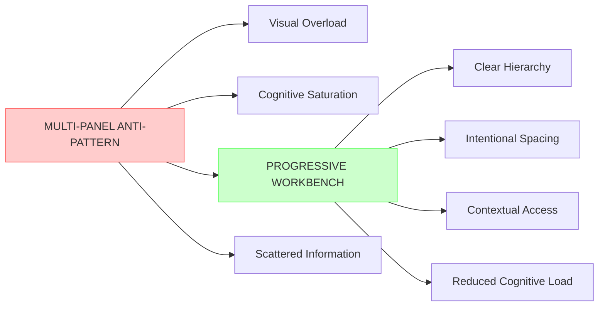
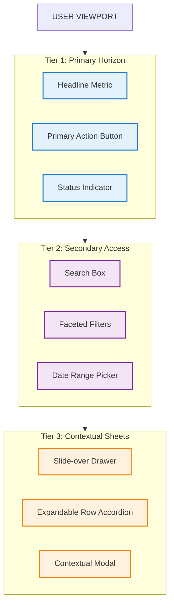
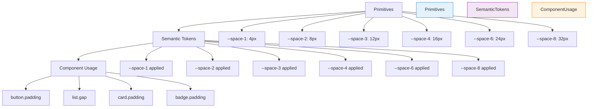
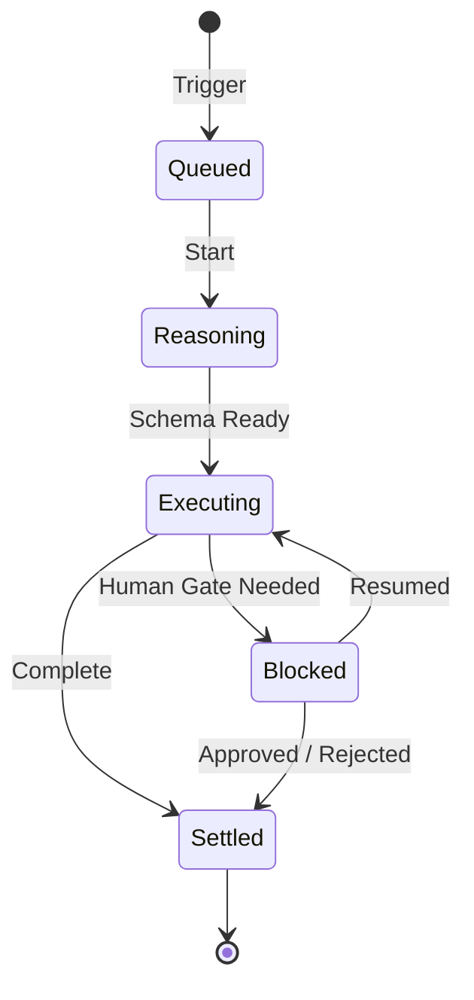

# Design Analysis: Principles, Skills, and Architectures for Premium Software UI/UX

---

## Executive Summary & Problem Framing

A pervasive failure in engineering-led software development is the **"Kitchen Sink Multi-Panel Anti-Pattern"**: sprawling, multi-column dashboard layouts where every widget, chart, metric, table, and operational toggle is rendered simultaneously on a single viewport. 

While ostensibly designed to "maximize information density," such interfaces inflict acute cognitive overload, destroy visual hierarchy, eliminate clear interaction paths, and produce an unpolished, prototype-like aesthetic.

Professional UI/UX engineers and product craftspeople distinguish high-leverage software through **spatial restraint, intentional typography, perceptual color geometry, optimistic feedback loops, progressive disclosure, and contextual workbenches**. In the modern era of autonomous AI agents and complex analytical pipelines, this discipline extends beyond human ergonomics into **Agent-Computer Interfaces (ACI)**, where tools, schemas, streaming telemetry, and speculative diffs are designed with identical aesthetic and systemic rigor.

This document compiles **56 foundational design skills, principles, laws, and craft rules** across six core dimensions:
1. **Cognitive Architecture & Spatial Restraint (Anti-Dashboard Doctrine)**
2. **Visual Craft, Layout Rhythm & Gestalt Mechanics**
3. **Interaction Ergonomics, Motion & Perceived Performance**
4. **Foundational Design Canons & Usability Heuristics**
5. **Modern AI & Agent Interface Architecture**
6. **Enterprise Design Systems, Tokens & Production Rigor**

---

# Dimension 1: Cognitive Architecture & Spatial Restraint (Anti-Dashboard Doctrine)

**Visual: Anti-Dashboard vs Progressive Workbench**



This diagram illustrates the fundamental contrast between cluttered multi-panel layouts (red nodes) and focused progressive workbenches (green nodes) that enable better user flow and clarity.

```
┌─────────────────────────────────────────────────────────────────────────┐
│ MULTI-PANEL ANTI-PATTERN (AVOID)        PROGRESSIVE WORKBENCH (PREMIUM) │
├───────────────────────────────────────┬─────────────────────────────────┤
│ [Panel 1] [Panel 2] [Panel 3] [Panel 4│  Primary Task Focused Horizon   │
│  MetricA   ChartB    LogList   Status │  • Clear Hierarchy & Contrast   │
│  FormX     ConfigY   StreamZ   Filter │  • Contextual Drawer / Popovers │
│  (Cognitive Saturation / Visual Noise)│  • 1-Click Drilldown on Demand  │
└───────────────────────────────────────┴─────────────────────────────────┘
```

**Visual: The Three-Tier Progressive Disclosure Horizon**



This flowchart shows how user attention moves from the primary overview (blue) through secondary zoom/filtering (purple) to contextual detail sheets (orange), never forcing all information onto one screen at once.
- **Origin / Canon:** Ben Shneiderman (*Visual Information Seeking Mantra*), Apple HIG.
- **The Core Thesis:** Never force the user to process secondary or tertiary details until they have explicitly requested them. The classic multi-panel mistake is putting configuration, execution logs, live graphs, and metadata side-by-side.
- **Engineering & Implementation Rule:**
  - Structure views into three strict horizons: **Overview** (headline status and primary metric) $\rightarrow$ **Zoom & Filter** (search, faceted attributes) $\rightarrow$ **Details-on-Demand** (slide-over sheets, contextual modals, expandable row drawers).
  - Use `disclosure` primitives (`<details>`, sheet drawers, or accordions) with keyboard focus management.
- **Agent / Software Applicability:** When an agent runs a pipeline, present the macro progress state and high-level diff first. Hide raw LLM prompts, token consumption traces, and AST transformations inside collapsible inspection sidebars.

### 2. Opinionated Defaults & Single-Purpose Views
- **Origin / Canon:** Karri Saarinen (Linear Method), Basecamp (*Shape Up*).
- **The Core Thesis:** Flexible software that forces users to configure layouts, pin panels, and build custom workspaces pushes product indecision onto the end-user.
- **Engineering & Implementation Rule:**
  - Build one exceptionally tuned workflow for the primary task. Refuse non-essential toggles.
  - Limit the number of persistent navigation panels to $\le 2$ (e.g., Slim navigation rail + Active workspace canvas).
  - If a feature is only used by 5% of users, place it behind a global command palette (`Cmd+K`) rather than cluttering persistent canvas chrome.

### 3. Hick’s Law: Logarithmic Decision Latency
- **Origin / Canon:** William Edmund Hick & Ray Hyman.
- **The Core Thesis:** The time required to make a decision increases logarithmically with the number and complexity of choices: $T = b \cdot \log_2(n + 1)$.
- **Engineering & Implementation Rule:**
  - Cap top-level toolbar actions at 3–5 items. 
  - Group secondary actions into an overflow menu (`...`) with standardized iconography and keyboard shortcuts.
  - In dropdown selects, categorize options with headers or provide client-side fuzzy searching if items exceed 7.

### 4. Miller’s Law & Strategic Chunking
- **Origin / Canon:** George A. Miller (1956), Cognitive Psychology.
- **The Core Thesis:** The human working memory can hold approximately $7 \pm 2$ (modern research suggests $4 \pm 1$) discrete information chunks simultaneously.
- **Engineering & Implementation Rule:**
  - Never display unstructured raw data lists. Partition complex data objects into visual clusters: Identity, Metrics, Status, and Relationships.
  - Group long forms into logical steps or multi-card fieldsets rather than a single vertical scroll of 30 inputs.

### 5. Tesler’s Law (The Law of Conservation of Complexity)
- **Origin / Canon:** Larry Tesler (Xerox PARC / Apple).
- **The Core Thesis:** Every application has an inherent amount of irreducible complexity. The only question is who absorbs it: the software developer/system or the end-user.
- **Engineering & Implementation Rule:**
  - Multi-panel HTML dashboards lazily offload state-routing complexity to users. Premium software absorbs this by writing automatic heuristics: smart filtering, auto-completion, contextual schema inferencing, and dynamic pre-computation.
  - Shift parsing, dialect resolution, and data linking to backend workers.

### 6. Calmer Interfaces: Hierarchy Doing the Ranking
- **Origin / Canon:** Linear Design Principles (*A Calmer Interface for a Product in Motion*).
- **The Core Thesis:** Dense interfaces feel calm when visual weight acts as a strict priority system. If every box has a dark border, high-contrast title, and saturated icon, every element screams for attention simultaneously.
- **Engineering & Implementation Rule:**
  - Navigation, chrome, and structural borders must recede into low-contrast neutral tones (`var(--border-subtle)`: opacity 0.06–0.12 in dark mode, hex `#E5E7EB` in light mode).
  - High saturation and high contrast are reserved strictly for user content, active selections, and critical error states.

### 7. Purpose-Driven Surface Partitioning (Strategy vs. Operation)
- **Origin / Canon:** Stephen Few (*Information Dashboard Design*).
- **The Core Thesis:** Analytical dashboards (historical trends, deep filters) and Operational workbenches (execution, triage, hotkey workflows) serve conflicting mental models and should never be merged into a single multi-panel mess.
- **Engineering & Implementation Rule:**
  - Partition views by intent:
    1. **Operational Views:** High-density, keyboard-driven, real-time status indicators, minimal decorative charts.
    2. **Strategic / Analytical Views:** Trend charts with historical baselines, delta comparisons, and aggregated summaries.

---

# Dimension 2: Visual Craft, Layout Rhythm & Gestalt Mechanics

```
┌─────────────────────────────────────────────────────────────────────────┐
│ GESTALT PROXIMITY & CONCENTRIC RADII                                    │
│                                                                         │
│   Outer Container (Padding: 16px, R_outer = 16px)                       │
│  ┌──────────────────────────────────────────────────────────────────┐   │
│  │  Inner Card (Padding: 12px, R_inner = 8px [16px - 8px])          │   │
│  │ ┌──────────────────────────────────────────────────────────────┐ │   │
│  │ │ Label (Subtle, 12px, uppercase tracking +0.05em)             │ │   │
│  │ │ Value: 1,482.00 (Tabular Nums, Inter/Geist font, Semibold)   │ │   │
│  │ └──────────────────────────────────────────────────────────────┘ │   │
│  └──────────────────────────────────────────────────────────────────┘   │
└─────────────────────────────────────────────────────────────────────────┘
```

### 8. Law of Proximity (Whitespace Grouping Over Box Enclosures)
- **Origin / Canon:** Max Wertheimer (Gestalt Psychology), Steve Schoger (*Refactoring UI*).
- **The Core Thesis:** Elements placed close to each other are perceived as belonging together. Junior engineers wrap every single item in a `<div class="card border">`; senior designers use intentional spacing ratios.
- **Engineering & Implementation Rule:**
  - The gap *between* distinct logical groups must be at least **$2\times$ to $3\times$** the gap *within* an individual group (e.g., title-to-description: `4px` or `8px`; group-to-group: `24px` or `32px`).
  - Eliminate 70% of unnecessary container outline borders by relying on proximity gaps.

### 9. Law of Common Region & Atmospheric Delimitation
- **Origin / Canon:** Palmer (1992), Gestalt Principles.
- **The Core Thesis:** Elements within a common bounded background color are perceived as a group, even without harsh lines.
- **Engineering & Implementation Rule:**
  - Replace harsh `1px solid #333` border lines with a subtle surface elevation background delta:
    - Base Canvas: `hsl(220, 15%, 8%)`
    - Card Surface: `hsl(220, 15%, 11%)`
    - Hover Surface: `hsl(220, 15%, 14%)`
  - Use `border: 1px solid rgba(255, 255, 255, 0.05)` to create an inner specular highlight rather than a dark separator.

### 10. Law of Similarity & Semantic Uniformity
- **Origin / Canon:** Gestalt Psychology.
- **The Core Thesis:** Visual elements sharing shape, color, typography, or size are perceived to share the same operational role.
- **Engineering & Implementation Rule:**
  - Reserve specific pill badge shapes exclusively for immutable status indicators (e.g., `Success`, `Failed`, `Pending`).
  - Interactive clickable filters must share a consistent visual signature (e.g., hover state with subtle border highlight and focus ring) distinct from static badges.

### 11. Strict 4px/8px Spatial Scale & Layout Rhythm
- **Origin / Canon:** Material Design, Vercel Geist Design System.
- **The Core Thesis:** Arbitrary margins (`margin: 13px`, `padding: 7px`) destroy visual cadence. Systematic layouts rely on an 8-point base grid with 4-point micro-adjustments.

**Visual: 4px/8px Spatial Scale Token Cascade**



Zero hardcoded manual pixel offsets are enforced; every spacing value maps to one of six token steps (`4, 8, 12, 16, 24, 32px`), guaranteeing layout rhythm across the entire product.

### 12. Optical Alignment vs. Mathematical Alignment
- **Origin / Canon:** Type Design Tradition & Rauno Freiberg (*Interfaces*).
- **The Core Thesis:** Mathematical centering based on bounding box geometry is often optically incorrect due to visual weight distribution.
- **Engineering & Implementation Rule:**
  - Triangular play icons inside circular buttons must be offset forward by `+1px` to `+2px` along the X-axis because their visual center of mass is shifted toward the flat edge.
  - Align icon glyphs to the **cap-height** of adjacent text rather than the font line-box height (`vertical-align: middle` or flexbox baseline nudges).

### 13. Border Pruning & Multi-Layer Ambient Shadow Elevation
- **Origin / Canon:** Refactoring UI, Apple macOS Human Interface Design.
- **The Core Thesis:** A single harsh drop-shadow (`box-shadow: 0 4px 10px #000`) looks cheap and unnatural. Realistic physical lighting features a dual-layer shadow (ambient occlusion + directional key light).
- **Engineering & Implementation Rule:**
  - Premium shadow recipe:
    ```css
    --shadow-elevated: 
      0 1px 2px 0 rgba(0, 0, 0, 0.05),              /* Key light contact edge */
      0 8px 16px -4px rgba(0, 0, 0, 0.12),          /* Ambient soft penumbra */
      0 0 0 1px rgba(255, 255, 255, 0.06) inset;     /* Top specular rim */
    ```

### 14. Concentric Nested Corner Radius Geometry
- **Origin / Canon:** UI Mathematics & Industrial Ergonomics.
- **The Core Thesis:** When an inner child element with a border-radius sits inside a padded parent container with a border-radius, mismatched radii cause optical pinching.
- **Engineering & Implementation Rule:**
  - Maintain the concentric mathematical formula:
    $$R_{\text{inner}} = R_{\text{outer}} - \text{Padding}$$
  - If parent has `border-radius: 16px` and `padding: 8px`, the inner child element MUST have `border-radius: 8px`. If $\text{Padding} \ge R_{\text{outer}}$, $R_{\text{inner}} = 0$ or minimum $2\text{px}$.

### 15. Tabular Numerals & Monospace Columnar Stability
- **Origin / Canon:** Typography Craft (Robert Bringhurst).
- **The Core Thesis:** Proportional number glyphs (where `1` is narrower than `8`) cause numbers, timers, prices, and table rows to jitter and wobble horizontally as data updates.
- **Engineering & Implementation Rule:**
  - Apply `font-variant-numeric: tabular-nums` or `font-feature-settings: "tnum" 1` across all data tables, live metrics, code execution timers, and pipeline counter badges.

### 16. Typographic Hierarchy, Golden Measure & Negative Tracking
- **Origin / Canon:** Emil Ruder (*Typographie*), Vercel Web Interface Guidelines.
- **The Core Thesis:** Premium typography relies on proportional scale ratios and line-length constraints, not just changing font weights randomly.
- **Engineering & Implementation Rule:**
  - **Optimal Measure:** Limit body text and documentation lines to **45–75 characters per line** (`max-width: 65ch`).
  - **Negative Letter-Spacing (Tracking):** Large headings ($\ge 24\text{px}$) require tighter tracking (`letter-spacing: -0.02em` to `-0.03em`) to prevent letters from drifting apart.
  - Small uppercase labels ($10\text{px}–12\text{px}$) require positive tracking (`letter-spacing: +0.05em` to `+0.08em`).

### 17. Perceptually Uniform Color Systems (OKLCH / LCH)
- **Origin / Canon:** Björn Ottosson (OKLCH Color Space), CSS Color Module Level 4.
- **The Core Thesis:** Standard sRGB and HSL color models suffer from non-uniform perceived lightness (e.g., pure blue has low luminance while pure yellow has high luminance at `L=50%`), breaking automated color scales and themes.
- **Engineering & Implementation Rule:**
  - Define theme palettes in `oklch()`:
    ```css
    --brand-primary: oklch(0.65 0.22 260);
    --brand-subtle:  oklch(0.92 0.04 260);
    --brand-surface: oklch(0.18 0.03 260);
    ```
  - Derive dark and light theme variations by altering only the lightness `L` coordinate while maintaining perceptual hue `H` and chroma `C`.

### 18. Perceptual Contrast Beyond WCAG 2: APCA
- **Origin / Canon:** Andrew Somers, W3C Accessible Perceptual Contrast Algorithm (WCAG 3).
- **The Core Thesis:** WCAG 2.1's mathematical ratio ($4.5:1$) frequently produces false positives on dark backgrounds (saying text is readable when it is blurry) and false negatives on light backgrounds.
- **Engineering & Implementation Rule:**
  - Target minimum APCA Lightness Contrast ($L_c \ge 60$) for content body text and ($L_c \ge 75$) for thin font weights.
  - Never convey critical system state using hue alone; always pair color with text tokens or iconic glyphs.

---

# Dimension 3: Interaction Ergonomics, Motion & Perceived Performance

```
┌─────────────────────────────────────────────────────────────────────────┐
│ INTERACTION LIFECYCLE: THE LATENCY MASKING PIPELINE                     │
│                                                                         │
│  User Action (Click/Key)                                                │
│      │                                                                  │
│      ├───► <16ms:  Instant Tactile Scale (0.97) + Optimistic Local DOM  │
│      │                                                                  │
│      ├───► <100ms: Async Worker/API Dispatched                          │
│      │                                                                  │
│      ├───► >300ms: (If still pending) Subtle Ambient indeterminate bar  │
│      │                                                                  │
│      └───► Settle: Reconcile Diff OR Silent Rollback with Undo Toast    │
└─────────────────────────────────────────────────────────────────────────┘
```

**Visual: Interaction Lifecycle Flowchart**


This chart shows the three branches: instant tactile feedback (red), fast reconciliation (<400ms, green), and slow response (>400ms, amber) with rollback and undo (blue).

### 19. The Doherty Threshold (<400ms Feedback Loop)
- **Origin / Canon:** Walter J. Doherty & Ahrvind J. Thadani (IBM Research, 1982).
- **The Core Thesis:** Productivity and user engagement increase exponentially when computer response times drop below 400 milliseconds, keeping the human mind in a continuous flow state.
- **Engineering & Implementation Rule:**
  - Immediate visual feedback (active press state, selection highlight, or optimistic mutation) must execute in **$\le 16\text{ms}$** (single animation frame).
  - For server actions taking $>400\text{ms}$, display contextual skeleton pacemakers rather than blocking modals.

### 20. Optimistic UI Mutations with Explicit Rollback Architecture
- **Origin / Canon:** Superhuman (*Engineered for Speed*), Apple HIG (*Forgiveness*).
- **The Core Thesis:** Waiting for a round-trip network response before updating the UI destroys the feeling of responsiveness.
- **Engineering & Implementation Rule:**
  - Update client state, DOM, and counters instantly upon user trigger.
  - Maintain a transactional reconciliation state: if the background API fails, seamlessly rollback the DOM change and trigger an actionable notification banner with a **"Retry"** or **"Details"** action.

### 21. Fitts’s Law & Edge Target Affordances
- **Origin / Canon:** Paul Fitts (1954).
- **The Core Thesis:** The time required to rapidly move to a target area is a function of the ratio between the distance to the target and the width of the target: $MT = a + b \log_2\left(\frac{2D}{W}\right)$.
- **Engineering & Implementation Rule:**
  - Interactive click/touch targets must have a minimum bounding area of **$24\times24\text{px}$** (desktop) and **$44\times44\text{px}$** (touch/mobile).
  - Small icons (e.g., $14\text{px}$ close icon) must have invisible padding (`padding: 6px; margin: -6px`) to widen the hit target.
  - Pin primary global actions to the viewport edges (top bar, screen corner, or bottom dock) where mouse cursor overshoot is mechanically bounded.

### 22. Keyboard-First Architecture & Global Command Palettes (`Cmd+K`)
- **Origin / Canon:** Linear, Sublime Text, Raycast.
- **The Core Thesis:** Power users and developers lose efficiency when forced to leave the home row to operate multi-level mouse drop-downs.
- **Engineering & Implementation Rule:**
  - Provide a universal Command Palette (`Cmd+K` / `Ctrl+K`) that searches local entity pools with fuzzy string matching (`fzy` / `Fuse.js`).
  - Implement **Roving Tabindex** or `aria-activedescendant` for full arrow-key list navigation, `Enter` to select, and `Escape` to dismiss.

### 23. Tactile Micro-Feedback & Active Scale Spring Physics
- **Origin / Canon:** Rauno Freiberg (*Interfaces*), Cultured Code (*Things 3*).
- **The Core Thesis:** Digital UI elements should respond with physical, tactile elasticity when pressed.
- **Engineering & Implementation Rule:**
  - Add active press micro-scales:
    ```css
    button:active {
      transform: scale(0.97);
      transition: transform 0.08s cubic-bezier(0.2, 0.8, 0.4, 1);
    }
    ```
  - Use physics-based spring damping curves rather than linear or standard bezier easings for dialog entries (`transform: scale(0.95) -> scale(1.0)` with spring damping).

### 24. Compositor-Only Animation Hygiene (Banning `transition: all`)
- **Origin / Canon:** Web Performance Working Group, Vercel WIG.
- **The Core Thesis:** Animating layout-triggering properties (`width`, `height`, `margin`, `top`, `padding`) forces synchronous CPU reflows and repaints, generating noticeable frame-drops (jank).
- **Engineering & Implementation Rule:**
  - Restrict CSS transitions strictly to GPU-composited properties: `transform` and `opacity`.
  - **Strict Ban:** Never write `transition: all 0.2s`. Always explicitly declare animated properties: `transition: transform 0.15s ease, opacity 0.15s ease`.

### 25. Contextual Surface Hierarchy: Modal vs. Sheet vs. Popover vs. Inline
- **Origin / Canon:** Nielsen Norman Group, Apple macOS/iOS Human Interface Guidelines.
- **The Core Thesis:** Throwing every user interaction into a centered modal dialog interrupts the user's mental model and context.
- **Engineering & Implementation Rule:**
  - **Popover:** For brief, localized adjustments (date picker, color picker, 2-item toggle).
  - **Inline Expansion / Accordion:** For expanding related sub-items within a table row or list.
  - **Slide-over Sheet (Drawer):** For high-density, multi-field inspections or sub-workflows where keeping background context visible is required.
  - **Centered Modal:** Strictly reserved for destructive confirmations, auth gates, or isolated creation wizards.

### 26. Actionable Empty States as Product Catalysts
- **Origin / Canon:** UX Archive, Basecamp.
- **The Core Thesis:** Blank screens displaying "No items found" feel broken and leave users stranded.
- **Engineering & Implementation Rule:**
  - Every empty state must contain three elements:
    1. A subtle, non-intrusive monochrome visual anchor (icon or illustration).
    2. A concise explanation of why the state is currently empty.
    3. A clear, primary CTA button to create the first record, seed sample data, or reset active filters.

### 27. Content-Aware Skeleton Layouts vs. Unstable Spinners
- **Origin / Canon:** Google Web Vitals (Cumulative Layout Shift - CLS).
- **The Core Thesis:** Generic spinning loaders reveal nothing about what is loading and cause jarring layout shifts when content pops in.
- **Engineering & Implementation Rule:**
  - Replace circular spinners with skeleton pulse blocks that mirror the exact dimensions, line counts, and border-radii of the incoming content.
  - Enforce zero Cumulative Layout Shift ($\text{CLS} < 0.05$) during async data resolution.

### 28. Reversibility & Universal Undo Over Blocking Dialogs
- **Origin / Canon:** Jef Raskin (*The Humane Interface*), Apple HIG (*Forgiveness*).
- **The Core Thesis:** "Are you sure?" modal dialogs train users to blindly hit Enter without reading, creating friction for routine tasks while failing to prevent genuine accidents.
- **Engineering & Implementation Rule:**
  - Make routine actions (deleting an item, archiving an issue, reassigning a task) execute immediately and surface a 6-second non-blocking Toast containing an **"Undo (Cmd+Z)"** trigger.
  - Reserve modal confirmations strictly for irreversible, catastrophic operations (e.g., permanent database dropping, billing plan changes).

---

# Dimension 4: Foundational Design Canons & Usability Heuristics

```
┌─────────────────────────────────────────────────────────────────────────┐
│ THE USABILITY COMPASS                                                   │
│                                                                         │
│   [Dieter Rams]            [Don Norman]             [Jakob Nielsen]     │
│   Less, but better.        Affordances,             Visibility of       │
│   No decorative fluff.     Signifiers &             System Status &     │
│   Every line earns place.  Mental Models.           Error Prevention.   │
└─────────────────────────────────────────────────────────────────────────┘
```

### 29. Dieter Rams Principle 10: "Good Design is as Little Design as Possible"
- **Origin / Canon:** Dieter Rams (Braun / Vitsœ, 1976).
- **The Core Thesis:** *Weniger, aber besser* (Less, but better). Design should not call attention to itself; it should elevate the utility of the artifact.
- **Engineering & Implementation Rule:**
  - Ruthlessly delete decorative gradients, unnecessary background cards, redundant badge colors, and non-functional divider lines.
  - If removing an element does not impair understanding or interaction, it was clutter.

### 30. Don Norman: Affordances, Signifiers & Feedback
- **Origin / Canon:** Don Norman (*The Design of Everyday Things*).
- **The Core Thesis:** An affordance is what an object can do; a signifier signals where the action should take place. Modern flat design often strips away signifiers, leaving users guessing what is clickable.
- **Engineering & Implementation Rule:**
  - Interactive items must show immediate hover signifiers (cursor change `cursor: pointer`, background luminescence shift, subtle icon chevron).
  - Never style static text to look like interactive links (e.g., avoid arbitrary blue underlined text for non-links).

### 31. Don Norman: Conceptual Mental Models & Natural Mapping
- **Origin / Canon:** Don Norman.
- **The Core Thesis:** The user forms an internal mental model of how the system operates. The interface controls must map naturally to spatial and physical expectations.
- **Engineering & Implementation Rule:**
  - If a list reorders vertically, drag handles and reorder animations must travel strictly on the Y-axis.
  - Volume/Zoom sliders must move left-to-right (low to high); toggles must switch right (on) with active color fill.

### 32. Jakob Nielsen: Visibility of System Status
- **Origin / Canon:** Jakob Nielsen (10 Usability Heuristics #1).
- **The Core Thesis:** The system should always keep users informed about what is going on, through appropriate feedback within a reasonable time.
- **Engineering & Implementation Rule:**
  - For background processes or batch mutations, display persistent ambient indicators (e.g., a slim 2px top loading bar, syncing indicator in the status rail, or badge counter).
  - Explicitly show offline, disconnected, or sync-reconnecting network states.

### 33. Jakob Nielsen: Error Prevention Over Error Messages
- **Origin / Canon:** Jakob Nielsen (10 Usability Heuristics #5).
- **The Core Thesis:** Better than even the best error messages is a careful design that prevents a problem from occurring in the first place.
- **Engineering & Implementation Rule:**
  - Disable invalid button states or show contextual tooltip explanations on why an action is currently unavailable.
  - Provide input masks and structured pickers (date pickers, numeric steppers) to eliminate syntax errors at the point of entry.

### 34. Jakob’s Law of Internet User Experience & The "Novelty Tax"
- **Origin / Canon:** Jakob Nielsen.
- **The Core Thesis:** Users spend most of their time on *other* software. They expect your software to work the same way as all the other software they already know.
- **Engineering & Implementation Rule:**
  - Every novel UI pattern charges a "novelty tax" on user cognition. Use standard conventions for table sorting, navigation tabs, settings gears, and search inputs unless your novel approach provides a $10\times$ measurable improvement.
  - "Be a piano, not an invented saxophone."

### 35. The Aesthetic-Usability Effect
- **Origin / Canon:** Masaaki Kurosu & Kaori Kashimura (1995), Nielsen Norman Group.
- **The Core Thesis:** Users perceive aesthetically pleasing design as design that is more usable and are significantly more tolerant of minor usability friction in high-craft interfaces.
- **Engineering & Implementation Rule:**
  - Visual polish (consistent margins, balanced typography, elegant contrast) is not mere decoration; it directly lowers anxiety and builds user trust during mission-critical tasks.

### 36. The Peak-End Rule & Closure Milestones
- **Origin / Canon:** Daniel Kahneman & Barbara Fredrickson (Behavioral Economics).
- **The Core Thesis:** People judge an experience largely based on how they felt at its peak (most intense point) and at its end, rather than the total sum or average of every moment.
- **Engineering & Implementation Rule:**
  - Design memorable, friction-free finishing moments: celebrate pipeline deployments, completed SQL imports, or clean zero-inbox states with subtle celebratory micro-animations.

### 37. Von Restorff (Isolation) Effect: Single Primary Anchor
- **Origin / Canon:** Hedwig von Restorff (1933).
- **The Core Thesis:** When multiple similar objects are present, the one that differs from the rest will be the most remembered and prioritized.
- **Engineering & Implementation Rule:**
  - Every screen or view must have exactly **ONE** primary visual anchor button (solid brand background).
  - All other actions on that screen must be secondary (outlined/ghost) or tertiary (plain text/icon). If three buttons are bright blue, none of them are primary.

### 38. Frictionless Form Ergonomics & The 16px Mobile Rule
- **Origin / Canon:** Luke Wroblewski (*Web Form Design*), iOS WebKit Specs.
- **The Core Thesis:** Badly structured forms cause the highest user abandonment rates in web applications.
- **Engineering & Implementation Rule:**
  - **16px Rule:** All text inputs must use `font-size: 16px` (or `1rem`) to prevent iOS Safari from aggressively auto-zooming into the page upon focus.
  - Top-align labels above inputs for fast saccadic scanning.
  - Associate `<label for="id">` explicitly and use HTML `autocomplete` attributes (`email`, `current-password`, `username`).

---

# Dimension 5: Modern AI, Autonomous Agent & LLM Interface Architecture

```
┌─────────────────────────────────────────────────────────────────────────┐
│ THE AI WORKBENCH PARADIGM                                               │
│                                                                         │
│  Traditional Chat (Weak)          The Structured Workbench (Premium)    │
│ ┌───────────────────────────┐    ┌──────────────┬──────────────────────┐│
│ │ User: Fix this SQL query. │    │ Issue/Context│ Speculative Diff     ││
│ │ Agent: Here is the code:  │    │ Linker       │ [- old_query       ] ││
│ │ ```sql                    │    │ Schema Tree  │ [+ new_query (opt) ] ││
│ │ SELECT * FROM table...    │    ├──────────────┴──────────────────────┤│
│ │ ```                       │    │ Agent Controls: [Approve] [Redirect]││
│ └───────────────────────────┘    └─────────────────────────────────────┘│
└─────────────────────────────────────────────────────────────────────────┘
```

**Visual: AI Workbench Paradigm**


Traditional chat (red) leaves execution to the user, while structured workbenches (green) embed AI directly in the domain context with diff staging and approval controls.

### 39. "Build the Workbench, Not Just the Chatbox"
- **Origin / Canon:** Karri Saarinen (*Design for the AI Age*), Anthropic (*Building Effective Agents*).
- **The Core Thesis:** A generic conversational chat bubble is an impoverished, low-precision interface for technical and structured domain workflows.
- **Engineering & Implementation Rule:**
  - Embed agent intelligence directly into the domain surfaces where work occurs (code editors, SQL consoles, schema explorers, review queues).
  - Surround AI operations with structured inspection panes, visual AST trees, schema validation badges, and contextual execution run-buttons.

### 40. Continuous Steerability, Interruption & Intervention Affordances
- **Origin / Canon:** Google PAIR (*People + AI Guidebook*), Microsoft HAX.
- **The Core Thesis:** Autonomous agent workflows cannot be black boxes. Users must have the ability to inspect intermediate reasoning, pause execution, inject constraints, and resume without losing state.
- **Engineering & Implementation Rule:**
  - Render agent step sequences as distinct interactive timeline nodes (`Planning` $\rightarrow$ `Schema Retrieval` $\rightarrow$ `SQL Transpilation` $\rightarrow$ `Security Gate`).
  - Provide a one-click **"Pause / Redirect"** affordance that halts the loop and opens a steering input box.

### 41. Progressive Token Streaming, Layout Locking & Visual Pacemakers
- **Origin / Canon:** Vercel AI SDK, OpenAI Streaming Guidelines.
- **The Core Thesis:** Streaming text generates rapid layout recalculations and vertical bouncing if container dimensions are not stabilized.
- **Engineering & Implementation Rule:**
  - Lock container minimum heights during streaming.
  - Use smoothed requestAnimationFrame token batching or CSS typing animations to eliminate raw string popping and jarring scroll jumps.
  - Keep scroll anchors pinned to the bottom only if the user is already at the bottom threshold (`scrollTop + clientHeight >= scrollHeight - 30px`).

### 42. Speculative Execution & Human-in-the-Loop Diff Staging
- **Origin / Canon:** Linear (*Diffs & Code Review in the Agent Era*), Apple Intelligence.
- **The Core Thesis:** When an agent writes code, modifies database records, or mutates configuration, showing raw markdown text creates cognitive drag.
- **Engineering & Implementation Rule:**
  - Render mutations as structured, syntax-highlighted **Diff Cards** showing explicit removals (`- red`) and additions (`+ green`).
  - Gate destructive/high-blast-radius actions behind single-click **"Apply Diff"** / **"Reject with Note"** triage controls.

### 43. Grounding, Provenance Badging & Inline Citation Breadcrumbs
- **Origin / Canon:** Google PAIR, Microsoft Research (*Human-AI Interaction*).
- **The Core Thesis:** Hallucinations erode trust. Users must be able to verify where every claim, column, or generated sub-clause originated.
- **Engineering & Implementation Rule:**
  - Attach interactive source pill badges to generated fields (e.g., `[users.created_at ↗]`, `[Schema Linker v2 ↗]`).
  - Hovering over a badge displays a floating popover showing the raw source table snippet or schema documentation reference.

### 44. Shared Multi-User Observability for Autonomous Agents
- **Origin / Canon:** Linear (*Issue Tracking is Dead, 2026*), Anthropic Agent Architecture.
- **The Core Thesis:** As agents perform engineering tasks asynchronously, agent sessions must be transparent and shared across team members rather than locked in private single-user tabs.
- **Engineering & Implementation Rule:**
  - Render agent runs with unique immutable URLs and real-time WebSocket state syncing.
  - Show live teammate cursors/viewers and log all steering interventions into an immutable audit trail.

### 45. Agent-Computer Interface (ACI) Craft (Tool Schemas as UI)
- **Origin / Canon:** Anthropic (*Writing Tools for Agents*), Stripe (*API as UI*).
- **The Core Thesis:** For agentic architectures, tool names, parameter schemas, error responses, and CLI outputs *are* user interfaces for LLMs. Poor schema naming causes agent hallucinations just as poor UI causes user errors.
- **Engineering & Implementation Rule:**
  - Write explicit docstrings and JSON Schema descriptions for tools.
  - Return structured, human-and-machine-readable error envelopes (`{ "error": "TableNotFound", "remedy": "Did you mean 'customer_orders'?" }`) so agents can auto-correct without looping.

### 46. Inference Context Window Budgeting & Just-in-Time Retrieval
- **Origin / Canon:** Anthropic (*Effective Context Engineering for AI Agents*).
- **The Core Thesis:** Dumping massive raw files into an LLM's prompt window causes "context rot," higher latency, and degraded reasoning accuracy.
- **Engineering & Implementation Rule:**
  - Implement two-stage Just-In-Time retrieval: use vector/BM25 search to pull candidate schema subsets, and feed only relevant table ASTs into the generation prompt.
  - Isolate sub-agents into scoped sandboxes that return concise JSON summaries to the parent orchestrator.

### 47. Microsoft HAX Guideline 1: Explicit Capability & Failure Expectations
- **Origin / Canon:** Microsoft Research (*Guidelines for Human-AI Interaction*).
- **The Core Thesis:** Set clear expectations about what the AI system can and cannot do before the user executes a task.
- **Engineering & Implementation Rule:**
  - Explicitly display dialect support tags, model versions, and sandbox limitations on the workspace header (e.g., `Dialect: PostgreSQL 16 • Safety Tier: Read-Only • Cost Limit: $0.05/query`).

### 48. Semantic Zoom & Narrative Diffs (Story-First Changelogs)
- **Origin / Canon:** Linear Diffs Architecture.
- **The Core Thesis:** When an agent generates 500 lines of modified SQL or code, human reviewers drown in raw diff chunks.
- **Engineering & Implementation Rule:**
  - Group diffs by intent and generate an automatic 2-sentence narrative summary at the top of the pull-request/diff card (e.g., *"Added compound index on `orders.user_id` and parameterized input literals to prevent SQL injection"*).

### 49. The Asynchronous Agent State Triad
- **Origin / Canon:** Distributed Systems UX & Agentic Workflow Design.
- **The Core Thesis:** An agent process has distinct lifecycle stages that must be visually unambiguous.
- **Engineering & Implementation Rule:**
  - Enforce visual tokens for the 5-state lifecycle:
    1. `Queued` (Muted gray pulse)
    2. `Reasoning / Planning` (Brand indigo shimmer)
    3. `Executing Tool / Mutation` (Amber glow)
    4. `Blocked on Human Gate` (High-contrast cyan badge + ring)
    5. `Settled` (Emerald green for Success, Rose red for Failure)

**Visual: Agent Lifecycle State Triad**



This diagram depicts the five-state asynchronous agent lifecycle using distinct visual tokens: gray pulse for queued, indigo shimmer for reasoning, amber glow for execution, cyan ring for human-blocked, and emerald/rose for settled outcomes.

### 50. Non-Destructive Canvas & Parallel Speculative Branching
- **Origin / Canon:** Figma FigJam, Anthropic Artifacts.
- **The Core Thesis:** Users should never fear losing their current work when experimenting with agent-generated alternatives.
- **Engineering & Implementation Rule:**
  - Provide instant side-by-side version comparison tabs (`Version A (Human)` vs `Version B (Agent Optimised)`).
  - Allow users to cherry-pick individual clauses or fields from an agent candidate without overwriting the master canvas.

---

# Dimension 6: Enterprise Design Systems, Tokens & Production Rigor

```
┌─────────────────────────────────────────────────────────────────────────┐
│ DESIGN SYSTEM TOKEN CASCADE                                             │
│                                                                         │
│  [Primitive Value]   ──►  [Semantic Token]   ──►  [Component Usage]     │
│   oklch(0.65 0.2 260)     --color-primary-action   button.background    │
│   8px                     --radius-sm              input.border-radius  │
│   4px                     --space-1                badge.padding-x      │
└─────────────────────────────────────────────────────────────────────────┘
```

### 51. Semantic Design Tokens as the Single Source of Truth
- **Origin / Canon:** Brad Frost (*Atomic Design*), Nathan Curtis, Figma Tokens.
- **The Core Thesis:** Hardcoding raw hex colors (`#3B82F6`) or pixel margins in component files creates technical debt and breaks universal theming.
- **Engineering & Implementation Rule:**
  - Build a 3-tier token architecture:
    1. **Global Primitives:** `--blue-500: #3B82F6;`
    2. **Semantic Aliases:** `--bg-surface-active: var(--blue-500);`
    3. **Component Scopes:** `--btn-primary-bg: var(--bg-surface-active);`

### 52. Dark Mode Craft: Tone Elevation Over Light Tinting
- **Origin / Canon:** Apple Human Interface Guidelines (*Dark Mode*), Material Design 3.
- **The Core Thesis:** Dark mode is not just black (`#000000`) with white text. Pure black causes intense eye strain and eliminates depth perception.
- **Engineering & Implementation Rule:**
  - Use deep slate/navy neutrals (`#0D1117`, `#161B22`) as canvas bases.
  - Express z-index elevation by progressively lightening surface backgrounds (higher surface = lighter tint + subtle specular rim highlight), never by adding thick white outlines.

### 53. Container Queries (`@container`) & Intrinsic Component Fluidity
- **Origin / Canon:** CSS Containment Module Level 3, Miriam Suzanne.
- **The Core Thesis:** Traditional viewport media queries (`@media (max-width: 768px)`) break reusable components placed inside dynamic multi-column layouts or expandable sidebars.
- **Engineering & Implementation Rule:**
  - Attach `@container` context to parent cards and let child components morph their layout (e.g., switching from horizontal stat pill to vertical metric card) based purely on the card's available width.

### 54. Data Grid & Dense Table Ergonomics
- **Origin / Canon:** Bloomberg Terminal UX, AG-Grid Design Best Practices.
- **The Core Thesis:** Complex analytical tools fail when tables lack sticky spatial anchors and responsive column clipping.
- **Engineering & Implementation Rule:**
  - Table headers MUST be sticky (`position: sticky; top: 0; z-index: 10; backdrop-filter: blur(8px)`).
  - Freeze primary identifier columns (e.g., ID or Name column) on the left during horizontal scrolling.
  - Right-align all numeric data and headers; left-align text data; center status badges.

### 55. "The Error is a Teacher": Actionable Error Envelopes
- **Origin / Canon:** Stripe API & Dashboard Design Standards.
- **The Core Thesis:** An error that simply says `"Error: 400 Bad Request"` or `"Syntax Error"` is an engineering failure.
- **Engineering & Implementation Rule:**
  - All UI error states must present:
    1. Plain-language explanation of what went wrong without raw stack traces in the primary view.
    2. The exact failing parameter or token location.
    3. An actionable **"Auto-Fix"** button or direct documentation link.

### 56. "Quality as a Trained Habit" (Quality Rituals & Zero-Bug Policy)
- **Origin / Canon:** Tuomas Artman & Karri Saarinen (*Quality Wednesdays*).
- **The Core Thesis:** Quality is not a final-pass QA phase; it is an active engineering discipline cultivated through continuous communal inspection.
- **Engineering & Implementation Rule:**
  - Institute recurring weekly UI polish sessions to triage micro-papercuts (misaligned icons, hover jank, clipping text, 100ms lag).
  - Enforce a strict zero-bug SLA for UI regressions: visual and interaction bugs take precedence over new feature scaffolding.

---

# Design System Quick Reference Matrix

| # | Skill / Principle | Primary Domain | Core Rule / Threshold | Key Benefit |
|---|---|---|---|---|
| **01** | Progressive Disclosure | Information Architecture | 3-Tier Horizon (Overview $\rightarrow$ Zoom $\rightarrow$ Details) | Eliminates multi-panel visual clutter |
| **02** | Opinionated Defaults | Product Strategy | Ship 1 great way; refuse speculative toggles | Eliminates user configuration fatigue |
| **03** | Hick's Law | Decision UX | $\le 5$ top actions; fuzzy search for $>7$ items | Accelerates decision velocity |
| **04** | Miller's Law / Chunking | Cognitive Load | Group complex records into $\le 4$ logical cards | Prevents working memory exhaustion |
| **05** | Tesler's Law | System Complexity | Absorb parsing/routing in code, not UI panels | Maximizes developer/user efficiency |
| **06** | Calmer Interfaces | Visual Hierarchy | Chrome recedes; content dominates | Ranks priority through contrast |
| **07** | Surface Partitioning | View Layout | Separate Operational workbenches from Analytics | Keeps mental models intact |
| **08** | Law of Proximity | Layout Spacing | Group gap $\ge 2.5\times$ internal item gap | Cuts 70% of unnecessary border lines |
| **09** | Common Region | Surface Design | Subtle background elevation deltas (2-5% lightness) | Replaces harsh borderlines with soft depth |
| **10** | Law of Similarity | Component Consistency | Status pills share identical shape & semantic color | Eliminates cognitive parsing ambiguity |
| **11** | 4px/8px Spatial Scale | Spatial Tokens | Strictly tokenized scale (`4, 8, 12, 16, 24, 32px`) | Guarantees layout rhythm |
| **12** | Optical Alignment | Micro-Craft | Nudge play icons $+1\text{px}$; align to cap-height | Fixes mathematical centering illusions |
| **13** | Ambient Shadow Tokens | Depth & Elevation | Dual-layer shadow (sharp contact + ambient blur) | Delivers premium tactile elevation |
| **14** | Concentric Corner Radii | Geometry | $R_{\text{inner}} = R_{\text{outer}} - \text{Padding}$ | Prevents optical corner pinching |
| **15** | Tabular Numerals | Typography | `font-variant-numeric: tabular-nums` on all metrics | Eliminates column number jitter |
| **16** | Measure & Tracking | Typography | 45–75 CPL; $-0.02\text{em}$ tracking on headings | Maximizes long-form legibility |
| **17** | OKLCH Color Geometry | Color Science | Uniform lightness across hues in `oklch()` | Flawless multi-theme derivation |
| **18** | APCA Contrast | Accessibility | Target $L_c \ge 60$ for body; pair color with icons | Guarantees real perceptual readability |
| **19** | Doherty Threshold | Performance | Visual feedback in $\le 16\text{ms}$; task loop $<400\text{ms}$ | Maintains user flow state |
| **20** | Optimistic UI Mutations | Network Ergonomics | Mutate DOM instantly; graceful rollback on error | Near-zero perceived latency |
| **21** | Fitts's Law | Hit Targets | Min $24\times24\text{px}$ (desktop), $44\times44\text{px}$ (touch) | Drastically reduces miss-clicks |
| **22** | Command Palette | Navigation | Global `Cmd+K` + roving tabindex keyboard paths | Power-user high-speed workflows |
| **23** | Tactile Micro-Feedback | Interaction | `scale(0.97)` active press + spring damping | Gives controls physical substance |
| **24** | Compositor Hygiene | CSS Performance | Animate only `transform` and `opacity`; ban `all` | Eliminates frame drops and jank |
| **25** | Surface Hierarchy | Viewport Chrome | Reserve modals for destructive gates; sheets for triage | Preserves context during subtasks |
| **26** | Actionable Empty States | Onboarding | Graphic + Reason + Single Primary Action CTA | Converts blank screens into launchpads |
| **27** | Skeleton Layouts | Perceived Speed | Dimension-matching pulse blocks; zero CLS | Prevents layout jumping |
| **28** | Universal Undo | User Forgiveness | 6s non-blocking toast with Undo over dialogs | Enables rapid, fearless action |
| **29** | Rams: Less, but better | Minimalism | Delete decorative lines/gradients without utility | Focuses 100% on the core task |
| **30** | Affordances & Signifiers | Intuitiveness | Explicit cursor & hover state shifts on clickables | Eliminates "mystery meat" navigation |
| **31** | Natural Mapping | Spatial Mental Model | Physical direction matches digital transformation | Makes interaction second nature |
| **32** | Visibility of Status | System State | Ambient background progress bars and sync badges | Eliminates state uncertainty |
| **33** | Error Prevention | Input Design | Input masks & disabled state tooltips | Blocks errors before execution |
| **34** | Jakob's Law | Platform Conventions | Standard conventions first; pay no novelty tax | Zero learning curve for newcomers |
| **35** | Aesthetic-Usability | Craft Psychology | High visual craft increases tolerance for friction | Builds deep product trust |
| **36** | Peak-End Rule | Emotion Design | Celebrate milestone finishes with micro-flourishes | Leaves lasting positive impression |
| **37** | Von Restorff Effect | Visual Hierarchy | Exactly ONE solid primary brand button per view | Unambiguous call to action |
| **38** | Form Ergonomics | Input Ergonomics | $16\text{px}$ mobile input rule + top-aligned labels | Smooth, high-conversion data entry |
| **39** | AI Workbench Model | AI/Agent UX | Embed intelligence in domain surfaces, not chat | Structured, high-precision results |
| **40** | Agent Steerability | AI/Agent UX | Steppable timeline nodes + Pause/Redirect buttons | Prevents runaway black-box loops |
| **41** | Streaming Pacemakers | AI/Agent UX | Lock container min-height + frame-synced streaming | Smooth text flow without jumping |
| **42** | Speculative Diffs | AI/Agent UX | Side-by-side syntax-highlighted diff cards | Clear inspection of agent actions |
| **43** | Grounding & Citations | AI/Agent UX | Interactive provenance pill badges + popover source | Complete factual verifiability |
| **44** | Shared Observability | AI/Agent UX | Unique run URLs + live multi-user cursor sync | Transparent team oversight |
| **45** | ACI Design Craft | Tool Ergonomics | Structured docstrings & actionable error JSON | Prevents agent hallucination loops |
| **46** | Context Budgeting | LLM Architecture | Two-stage JIT retrieval; compact summaries | Eliminates context rot and slowness |
| **47** | HAX Capability Gate | AI Expectation | Clear dialect/quota/model tags on workspace header | Anchors user expectations |
| **48** | Narrative Diffs | Review Ergonomics | Intent-based story summary above raw code diffs | Fast comprehension of agent PRs |
| **49** | Agent State Triad | Lifecycle Status | Distinct tokens for Queued/Reasoning/Blocked/Done | Crystal-clear async awareness |
| **50** | Speculative Canvas | Interaction Safety | Non-destructive branching & side-by-side versions | Safe exploration of AI outputs |
| **51** | Semantic Tokens | System Tokens | 3-tier cascade: Primitives $\rightarrow$ Semantics $\rightarrow$ Components | Seamless theme maintenance |
| **52** | Dark Mode Elevation | Color Scheme | Surface lightening + specular rims over white borders | High depth without visual fatigue |
| **53** | Container Queries | Layout Engine | `@container` rule for responsive component layout | True component portability |
| **54** | Data Grid Ergonomics | Table Design | Sticky headers, frozen axes, right-aligned nums | Industrial-grade data readability |
| **55** | Actionable Errors | Resilience | Clear error reason + Auto-Fix button | Turns failure into immediate recovery |
| **56** | Quality Rituals | Engineering Culture | Weekly Quality sessions + Zero-UI-debt policy | Compounding software excellence |

---

# The Polished UI/UX Engineer's Code Checklist

Before shipping any interface, execute this comprehensive verification pass:

```markdown
### 1. Spatial & Hierarchy Audit
- [ ] Has the "multi-panel kitchen sink" been dismantled into a focused primary canvas with contextual slide-overs/drawers?
- [ ] Does every border, separator, and box earn its existence? Can 50% of borders be replaced with whitespace proximity?
- [ ] Is there exactly ONE solid primary CTA on screen?
- [ ] Are concentric corner radii mathematically maintained ($R_{inner} = R_{outer} - \text{padding}$)?

### 2. Typography & Color Precision
- [ ] Is `font-variant-numeric: tabular-nums` applied to all data tables, counters, and timers?
- [ ] Are headings tightened with negative tracking ($-0.02\text{em}$ to $-0.03\text{em}$) and long text capped at $65\text{ch}$ measure?
- [ ] Are color tokens derived in perceptual color spaces (`oklch`) with verified APCA contrast ($L_c \ge 60$)?
- [ ] Is dark mode depth created via progressive surface lightening rather than harsh white borders?

### 3. Interaction & Motion Hygiene
- [ ] Does every clickable element provide immediate active press feedback (`scale(0.97)`) and visible `:focus-visible` rings?
- [ ] Are CSS transitions restricted strictly to `transform` and `opacity` (zero `transition: all`)?
- [ ] Do routine mutations feature optimistic local updates with non-blocking Undo toasts ($6\text{s}$ window)?
- [ ] Are mobile inputs set to $\ge 16\text{px}$ to prevent iOS viewport auto-zoom?

### 4. AI & Agent Surface Polish
- [ ] Is the agent presented as a structured workbench with diff staging rather than a detached chatbox?
- [ ] Are agent actions steerable with pause/redirect affordances and distinct lifecycle tokens?
- [ ] Are generated claims and SQL columns grounded with interactive citation badges and provenance popovers?
- [ ] Does streaming text maintain layout height locks to eliminate Cumulative Layout Shift (CLS)?
```
