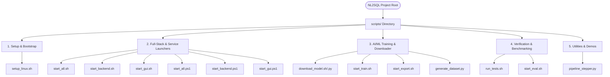

<div align="center">

# Cross-Platform Automation & Execution Scripts

### Complete CLI & GUI Orchestration Suite for Windows, Linux, & macOS

[](https://github.com/VanshikaKritiSingh/NL2SQL)
[](https://github.com/VanshikaKritiSingh/NL2SQL)
[](../docs/html/nl2sql.html)
[](../docs/diagrams/SVG_DIAGRAM.svg)
[](https://github.com/VanshikaKritiSingh/NL2SQL)
[](https://github.com/VanshikaKritiSingh/NL2SQL)

<br />

[Root Overview](../README.md) &bull; [Visual Blueprint](../docs/diagrams/SVG_DIAGRAM.svg) &bull; [Interactive Spec](../docs/html/nl2sql.html) &bull; [Core AI/ML Engine](../core/README.md) &bull; [Studio GUI](../GUI/README.md) &bull; [Offline Models](../offline/models/README.md)

</div>

<br />

---

## Architecture & Script Matrix

Scripts in this directory orchestrate complete environment setup, backend/frontend launching, ML pipeline, dataset generation, model downloading, and benchmarking. **Supported platforms: Linux/macOS (`.sh`), Windows (`.ps1`), and Python (`.py`).**



> **Note:** For each workflow, both Bash and PowerShell scripts are available for Linux/macOS and Windows. All key pipelines can also be driven using the provided Python entrypoints.

---

## Complete Script Catalog

| Task / Purpose                    | Linux/macOS (Bash)                 | Windows (PowerShell)                | Python (Cross-Platform)          | Description |
| :-------------------------------- | :--------------------------------- | :---------------------------------- | :------------------------------- | :---------- |
| **Full Environment Setup**        | `setup_linux.sh`                   | —                                  | —                               | Installs .venv, pip packages, GUI npm packages, creates dataset |
| **Start Full Stack**              | `start_all.sh`                     | `start_all.ps1`                    | —                               | Launches backend (8000) + Web Studio (5173)/Electron |
| **Start Backend Server**          | `start_backend.sh`                 | `start_backend.ps1`                | —                               | Launches FastAPI backend at 127.0.0.1:8000 (hot-reload) |
| **Start Frontend UI**             | `start_gui.sh`                     | `start_gui.ps1`                    | —                               | Launches Vite Web Studio/Electron desktop (`--desktop`) |
| **Download Base Model**           | `download_model.sh`                | —                                  | `download_model.py`             | Downloads Qwen2.5-Coder presets from Hugging Face |
| **Generate Synthetic Dataset**    | —                                  | —                                  | `generate_dataset.py`           | Creates instruction-tuning datasets in `offline/datasets/` |
| **Run All Tests**                 | `run_tests.sh`                     | —                                  | —                               | Runs `pytest` and backend integration test suite |
| **Fine-Tune Model (QLoRA)**       | `start_train.sh`                   | —                                  | —                               | QLoRA 4-bit fine-tuning on consumer GPU/CPU |
| **Benchmark Evaluation**          | `start_eval.sh`                    | —                                  | —                               | Benchmarks SQL AST/EX accuracy |
| **LoRA Merge & GGUF Export**      | `start_export.sh`                  | —                                  | —                               | Merges LoRA, prepares GGUF/Ollama modelfiles |
| **Pipeline Step Demo (TUI)**      | —                                  | —                                  | `pipeline_stepper.py`           | Interactive step-by-step terminal pipeline demo |

---

## Usage Quick Reference

### Unified Full-Stack Launcher
```sh
# Linux / macOS
./scripts/start_all.sh
# Windows PowerShell
./scripts/start_all.ps1
# With Electron GUI (both platforms)
./scripts/start_all.sh --desktop
./scripts/start_all.ps1 -Desktop
```

### Start Backend/API
```sh
./scripts/start_backend.sh
./scripts/start_backend.ps1           # PowerShell
```

### Start Frontend/UI
```sh
./scripts/start_gui.sh
./scripts/start_gui.ps1               # PowerShell
./scripts/start_gui.sh --desktop      # Electron GUI
./scripts/start_gui.ps1 -Desktop
```

### Download Foundational Models
```sh
./scripts/download_model.sh --preset 7b
python scripts/download_model.py --preset 7b
```

### Generate Synthetic Dataset
```sh
python scripts/generate_dataset.py
```

### Run Tests & Evaluate
```sh
./scripts/run_tests.sh
./scripts/start_eval.sh
```

### Fine-Tune/Export Models (QLoRA)
```sh
./scripts/start_train.sh
./scripts/start_export.sh
```

### Interactive Pipeline Stepper Demo (TUI)
```sh
python scripts/pipeline_stepper.py
```

---

## Volume Protection & `.gitignore` Compliance

- Large models: kept in `offline/models/`, not committed.
- Training checkpoints: `offline/checkpoints/`, not committed.
- Synthetic datasets: generated in `offline/datasets/`, git-ignored.
- Total repository size kept under 15 MB for easy cloning.

---

## Related Documentation

- [Root Pipeline Overview](../README.md)
- [Interactive HTML Architecture Spec](../docs/html/nl2sql.html)
- [Master Blueprint (SVG)](../docs/diagrams/SVG_DIAGRAM.svg)
- [Core AI/ML Engine Handbook](../core/README.md)
- [Desktop & Web Studio Handbook](../GUI/README.md)
- [Offline Model Registry](../offline/models/README.md)

---

<div align="center">

*NL2SQL Environment Scripts: Complete Cross-Platform Specification*

</div>
